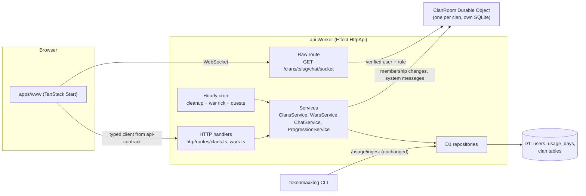
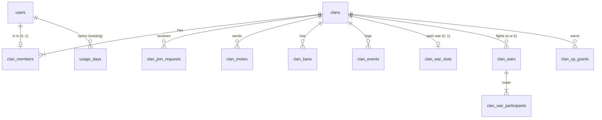

# Tokenmaxxing Clan Edition: Implementation Plan

> Status: approved for implementation, one task per PR. Grounded against `main` at `0a02787` on 2026-11-07.
> Supersedes the earlier 161-item checklist (commit `13eaa65`); task IDs below are new.
>
> Agents: read [section 1](#1-how-to-use-this-plan) first. Your task spec in [section 11](#11-task-specs) tells you
> which other sections are required reading.

## Contents

1. [How to use this plan](#1-how-to-use-this-plan)
2. [What we are building](#2-what-we-are-building)
3. [Rules that must not break](#3-rules-that-must-not-break)
4. [Decisions](#4-decisions)
5. [Architecture](#5-architecture)
6. [Code structure](#6-code-structure)
7. [Database design](#7-database-design)
8. [API surface](#8-api-surface)
9. [Roles and permissions](#9-roles-and-permissions)
10. [Task board](#10-task-board)
11. [Task specs](#11-task-specs)
12. [Definition of done](#12-definition-of-done)
13. [Out of scope](#13-out-of-scope)

---

## 1. How to use this plan

**For the person handing out work**

- Work through the [task board](#10-task-board) top to bottom. A task can start once every task in its `Depends on`
  list has merged.
- Tasks in the same phase with no dependency between them can run in parallel (the board marks them).
- If you want to change a default in [section 4](#4-decisions), edit the table **before** the dependent task starts,
  not during review.

**For the implementing agent**

1. Read sections [3](#3-rules-that-must-not-break), [5](#5-architecture), [6](#6-code-structure) and your task spec.
   Read [7](#7-database-design), [8](#8-api-surface) and [9](#9-roles-and-permissions) when your task touches the
   database, the contract or permissions.
2. Implement only your task. If you find the plan is wrong or missing something, implement the smallest correct
   thing, then say so in the PR description under **Plan deviations**. Do not silently redesign.
3. Before opening the PR, run `bun run check` and `bun run test` from the repo root. Both must pass with clean
   output (see `AGENTS.md`).
4. Meet the [definition of done](#12-definition-of-done).

**Brief template** (paste into the agent prompt):

```text
Implement CLAN-XXX from docs/clan-feature-index.md in this repo.
Read section 1, section 3, section 5, section 6 and the CLAN-XXX spec in section 11, plus any sections
the spec lists. Follow AGENTS.md. One focused PR; list any plan deviations in the PR description.
Run `bun run check` and `bun run test` before finishing.
```

---

## 2. What we are building

Tokenmaxxing today: a CLI syncs each device's daily coding-agent token counts and API-equivalent spend into D1
(`usage_days`); the site shows public profiles and a 7d/30d/all-time leaderboard ranked by spend or tokens.

Clan Edition adds a team layer on top of those same numbers. It is a friendly competition over token usage. It
does not measure code quality or productivity, and it never reads prompts, code or raw logs.

The player loop:

1. **Join a clan.** Find one on `/clans`, or create your own. Clans have a leader, co-leaders and members.
2. **Contribute.** Your synced usage from the day you joined counts towards your clan's totals. Clans rank on a
   clan leaderboard.
3. **Talk.** Each clan has a live chat room.
4. **Fight.** Leaders challenge other clans to **clan wars**: equal-size rosters, a fixed window of days, and the
   roster with the most tokens wins.
5. **Grow.** Wars and weekly cooperative quests earn clan XP and levels, which unlock cosmetic badges.

Delivery order: clan core, then clan stats and leaderboard, then chat, then wars, then progression, then social and
safety. Each phase ships to users on its own.

---

## 3. Rules that must not break

### 3.1 Existing invariants (from `AGENTS.md` and the code)

| Rule                   | What it means for clan work                                                                                                                                                                                                                                                |
| ---------------------- | -------------------------------------------------------------------------------------------------------------------------------------------------------------------------------------------------------------------------------------------------------------------------- |
| Sync stays as is       | No clan task changes `/usage/ingest`, `/usage/sync`, `usage_days` writes, `PARSER_VERSION` or cost freezing. Clan features **only read** `usage_days`.                                                                                                                     |
| CLI contract is frozen | `packages/api-contract/fixtures/` and the CLI OpenAPI slice (`cli-endpoints.test.ts`) must not change. Never add fields to `MeResponse` or other CLI-used schemas; use new endpoints. `fixtures/full-api.openapi.json` **will** change and is updated in each contract PR. |
| Day keys are opaque    | `date` / `*_day` values are `YYYY-MM-DD` strings. Use `utcDayKey` / `shiftDayKey` from `@tokenmaxxing/api-contract`; never `new Date(dayKey)`.                                                                                                                             |
| D1 bind limit          | Max 100 bound parameters per statement (the test harness enforces it). Chunk lists or pass one JSON parameter through `json_each`.                                                                                                                                         |
| Public user shape      | Public endpoints expose users only through `publicUserColumns` (`login`, `name`, `avatarUrl`). Internal user IDs never reach public responses; public paths address users by `login`.                                                                                      |
| Shadow bans            | Every public aggregate over `usage_days` goes through `visibleUsage` / `visibleUsageFilter` in `apps/api/src/usage/visible.ts`.                                                                                                                                            |
| Effect errors          | Wire errors are `Schema.TaggedError` in the contract. Internal errors are `Data.TaggedError`. Expected failures use `Effect.fail`, never `throw`. Repositories fail with `DatabaseError`; services turn it into a defect with `Effect.orDie`.                              |
| Export style           | Local declarations first, grouped `export { ... }` / `export type { ... }` at the end of each file.                                                                                                                                                                        |
| Clean tests            | `bun run test` output stays clean. Use `makeTestLogger` / `app.logs` for log paths.                                                                                                                                                                                        |

### 3.2 Clan invariants (new; enforced by the database or a single code path)

1. **One clan per user.** `clan_members.user_id` is the primary key.
2. **Exactly one leader per active clan.** A partial unique index allows at most one; every write that removes a
   leader either installs another leader in the same D1 batch or disbands the clan.
3. **Capacity.** `member_count <= max_members`, enforced inside the same SQL statement that inserts the member.
4. **One open war per clan.** `clan_war_slots.clan_id` is the primary key.
5. **Clan scores are computed at read time from `usage_days`.** Nothing copies usage into clan tables except the
   final, frozen war result.
6. **Idempotent rewards.** Every XP grant has a unique `source_key`.
7. **Account merges keep clan data.** `mergeUsers` re-points every clan table (see [7.5](#75-account-merges)).
8. **Permissions live in one module** (`apps/api/src/clans/policy.ts`). Handlers and the UI never re-derive them;
   the API returns the viewer's allowed actions.

---

## 4. Decisions

### 4.1 Locked defaults (implement these)

| ID   | Decision               | Default                                                                                                                                                                                                                                                                                                                                                                                                   |
| ---- | ---------------------- | --------------------------------------------------------------------------------------------------------------------------------------------------------------------------------------------------------------------------------------------------------------------------------------------------------------------------------------------------------------------------------------------------------- |
| D-01 | Clans per user         | One. Leaving is required before joining another clan.                                                                                                                                                                                                                                                                                                                                                     |
| D-02 | Roles                  | `leader`, `co_leader`, `member`. Rank order leader > co_leader > member, so an `elder` role can be slotted in later without a migration.                                                                                                                                                                                                                                                                  |
| D-03 | Capacity               | 50 members, stored per clan in `max_members` so levels can raise it later.                                                                                                                                                                                                                                                                                                                                |
| D-04 | Identity               | `slug`: 3–32 chars `[a-z0-9-]`, no leading or trailing hyphen, unique among active clans, **immutable** (no redirects needed). `name`: 2–32 chars, editable. `tag`: 2–5 chars `[A-Z0-9]`, editable, not unique. `badge`: one of a fixed preset list (no uploads). Reserved slugs: `new`, `me`, `leaderboard`, `discover`, `wars`, `settings`.                                                             |
| D-05 | Join policy            | `open` (instant join), `request` (leader or co-leader approves), `invite` (invite only). Plus `listed` (shown in discovery or not). Defaults: `request`, listed.                                                                                                                                                                                                                                          |
| D-06 | What counts for a clan | A member's visible usage dated **on or after the UTC day they joined** (`joined_day`), and only while they are a member. Leaving removes their past contribution from rolling totals. This stops one heavy user from carrying their history from clan to clan. Day-boundary wobble of ±1 day is accepted, same as the existing leaderboard.                                                               |
| D-07 | Clan leaderboard       | Same metrics and windows as the user leaderboard (`spend` or `tokens`, `7d`/`30d`/`all`, default 30d spend). Eligible clans have at least 3 members with visible usage in the window. Ties are broken by clan id, like users.                                                                                                                                                                             |
| D-08 | Requests and invites   | Requests expire after 14 days, invites after 7. A user can have at most 5 pending outgoing requests. Joining any clan deletes the user's other pending requests and invites.                                                                                                                                                                                                                              |
| D-09 | Kick and ban           | Kick removes the member and adds a 24-hour clan ban. Ban is indefinite until lifted (optional expiry). Leaving has no cooldown.                                                                                                                                                                                                                                                                           |
| D-10 | Leader leaving         | A leader must transfer leadership first. If the leader is the only member, leaving disbands the clan (the UI confirms first). No automatic inactive-leader handoff yet (see O-04).                                                                                                                                                                                                                        |
| D-11 | Disband                | Soft delete (`status = 'disbanded'`): memberships, requests, invites and bans are deleted; events and war history stay. The slug becomes free. Blocked while the clan has an open war.                                                                                                                                                                                                                    |
| D-12 | Shadow-banned users    | They can be members. Their usage never counts toward clan totals or war scores, and non-members do not see them in the roster.                                                                                                                                                                                                                                                                            |
| D-13 | Chat                   | One Durable Object per clan stores messages and fans them out over hibernating WebSockets (see [5.4](#54-chat)). Plain text, 1–2000 chars, links not auto-embedded. Authors can edit within 15 minutes and delete anytime; leader and co-leaders can delete any message. Retention: 90 days or the latest 5,000 messages per clan, whichever keeps less.                                                  |
| D-14 | War format             | Direct challenge between two clans (no matchmaking yet). Roster size 5, 10, 15 or 20; duration 3 or 7 days. The challenge expires after 48 hours. On accept: `start_day = utcDayKey(acceptedAt) + 2`, `end_day = start_day + duration − 1`, finalize at 00:00 UTC on `end_day + 3` (2 full days for late syncs).                                                                                          |
| D-15 | War roster             | During prep, members of each clan opt in; the leader or a co-leader can remove opt-ins. At start, the first `roster_size` opt-ins (by opt-in time) are locked and the rest are benched. A clan with fewer opt-ins fights short-handed. If either clan has zero participants, the war is cancelled. A locked roster is frozen: a participant who leaves or is kicked still counts for their original clan. |
| D-16 | War score              | Formula v1: sum of `total_tokens` from visible `usage_days` rows of locked participants with `start_day <= date <= end_day`. Equal scores are a draw. The final result is snapshotted at finalization and never recomputed, even if later syncs or parser bumps change `usage_days`. This matches the cost-freeze spirit.                                                                                 |
| D-17 | Progression            | XP only (level is derived from XP in code). War: win 100, draw 60, loss 30; a clan needs at least 3 locked participants to earn war XP. Weekly quest: 50. Level `n` needs `250 × n × (n + 1) / 2` total XP. Perks are cosmetic only (badge frames).                                                                                                                                                       |
| D-18 | Rollout gate           | A constant `CLANS_ROLLOUT: "off" \| "admins" \| "all"` in `apps/api/src/config.ts` (same style as `adminEmails`). While it is `admins`, non-admin callers get `ClanNotFound` / `enabled: false`.                                                                                                                                                                                                          |
| D-19 | Notifications          | MVP has no notifications table: `/me/clan` derives the inbox (my invites, my pending requests, and pending requests to review for leader or co-leader) from state tables. A real notifications table arrives in Phase 6.                                                                                                                                                                                  |

### 4.2 Open decisions (do not implement until resolved)

| ID   | Question                                                                    | Blocks   |
| ---- | --------------------------------------------------------------------------- | -------- |
| O-01 | Matchmaking and a war rating (for example Elo) for random opponents         | Phase 7  |
| O-02 | Seasons and leagues: length, reset rules, rewards                           | Phase 7  |
| O-03 | Friends (mutual) or follows (one-way)                                       | CLAN-604 |
| O-04 | Inactive-leader policy, for example auto-transfer after N days without sync | Phase 7  |
| O-05 | Chat mentions, reactions and pins                                           | Phase 7  |
| O-06 | Delivery beyond in-app notifications (email or push)                        | Phase 7  |

---

## 5. Architecture

### 5.1 Components



- **D1** is the source of truth for clans, membership, roles, wars and XP.
- **ClanRoom Durable Object** is the source of truth for chat messages and read cursors. It never decides
  membership; the Worker tells it who may connect.
- **No new ingestion.** Clan stats, leaderboards and war scores are SQL over `usage_days`, reusing
  `visibleUsage`.

### 5.2 Scoring from usage

All clan numbers come from one query module, `apps/api/src/clans/queries.ts`, built the same way as
`apps/api/src/usage/ranking.ts`:

```sql
-- Clan totals for a window (D-06). :since is NULL for all time.
SELECT m.clan_id,
       sum(u.total_tokens) AS total_tokens,
       sum(u.cost_usd)     AS spend_usd,
       count(DISTINCT u.user_id) AS contributing_members
FROM clan_members m
JOIN users us      ON us.id = m.user_id AND us.shadow_banned_at IS NULL
JOIN usage_days u  ON u.user_id = m.user_id
                  AND u.date >= max(coalesce(:since, m.joined_day), m.joined_day)
                  AND u.date <= :until            -- latestUsageDateKey(now)
JOIN clans c       ON c.id = m.clan_id AND c.status = 'active' AND c.hidden_at IS NULL
GROUP BY m.clan_id
```

- `u.user_id` plus a `date` range seeks `usage_days_user_date_cost_tokens_idx`, which already covers
  `cost_usd` and `total_tokens`, so the query is index-only on `usage_days`.
- Reuse `usageAggregates` / `usageMetric` from `usage/aggregates.ts` for the sums and the ranking expression.
  Express the shadow-ban filter through `visibleUsageFilter` rather than writing it again.
- War scores use the same join, with the locked roster and the war's day range instead of `clan_members`.

### 5.3 Safe writes on D1

D1 has no interactive transactions. `db.batch([...])` is the atomic unit, and statements in a batch cannot branch
on each other's results. Every multi-row clan write follows the **guarded batch** pattern:

1. **Guarded first statement.** It makes the state change only if every precondition holds, inside SQL
   (`INSERT ... SELECT ... WHERE <preconditions>` or `UPDATE ... WHERE <expected state>`).
2. **Follow-ups re-check the result.** Every later statement in the batch is guarded by
   `WHERE EXISTS (<post-condition of step 1>)`, so if step 1 changed nothing, the follow-ups do nothing too.
3. **Classify zero changes.** If step 1 reports 0 changes, do one read to work out why and fail with the right typed
   error (`ClanFull`, `BannedFromClan`, `AlreadyInClan` and so on).

Example: joining a clan.

```ts
// apps/api/src/clans/writes.ts (sketch; build with drizzle `sql`, bind ≤ 100 params)
const joined = sql`EXISTS (SELECT 1 FROM clan_members WHERE user_id = ${userId} AND clan_id = ${clanId})`;
await db.batch([
  db.run(sql`
    INSERT INTO clan_members (user_id, clan_id, role, joined_at, joined_day)
    SELECT ${userId}, c.id, 'member', ${nowMs}, ${dayKey} FROM clans c
    WHERE c.id = ${clanId} AND c.status = 'active' AND c.member_count < c.max_members
      AND NOT EXISTS (SELECT 1 FROM clan_members WHERE user_id = ${userId})
      AND NOT EXISTS (SELECT 1 FROM clan_bans b WHERE b.clan_id = c.id AND b.user_id = ${userId}
                      AND (b.expires_at IS NULL OR b.expires_at > ${nowMs}))`),
  db.run(sql`UPDATE clans SET member_count = (SELECT count(*) FROM clan_members WHERE clan_id = ${clanId}),
             updated_at = ${nowMs} WHERE id = ${clanId} AND ${joined}`),
  db.run(sql`DELETE FROM clan_join_requests WHERE user_id = ${userId} AND ${joined}`),
  db.run(sql`DELETE FROM clan_invites WHERE user_id = ${userId} AND ${joined}`),
  db.run(sql`INSERT INTO clan_events (clan_id, type, actor_user_id, data, created_at)
             SELECT ${clanId}, 'member_joined', ${userId}, '{}', ${nowMs} WHERE ${joined}`),
]);
```

Note that `joined` alone cannot tell "just joined" from "was already a member". Statement 1 excludes existing
members, so a re-run is a no-op apart from the follow-ups, which are idempotent. Put these builders in
`clans/writes.ts`, each with a repository test that runs it twice and runs it against a full or banned clan.

### 5.4 Chat

**Options considered**

| Option                                                                            | Verdict                                                                                                                                                                                                                                                                                                                                                                                      |
| --------------------------------------------------------------------------------- | -------------------------------------------------------------------------------------------------------------------------------------------------------------------------------------------------------------------------------------------------------------------------------------------------------------------------------------------------------------------------------------------- |
| Durable Object per clan + hibernating WebSockets; messages in the DO's own SQLite | **Chosen.** One ordered writer per room, fan-out built in, idle sockets cost nothing while hibernated, and chat writes stay off the single D1 database that ingestion also uses. Alchemy `2.0.0-beta.84` supports this (`Cloudflare.DurableObject`, `Cloudflare.upgrade()`, `state.getWebSockets()`; see `demos/effect-prezzy/chapters/04-durable-objects` in the alchemy repo at that tag). |
| Messages in D1 + HTTP polling                                                     | Fallback only. It needs no new infrastructure but adds polling load and write contention on D1.                                                                                                                                                                                                                                                                                              |
| Server-Sent Events                                                                | No better than WebSockets here and still needs a fan-out coordinator.                                                                                                                                                                                                                                                                                                                        |
| Queues                                                                            | Asynchronous delivery only; not a chat transport.                                                                                                                                                                                                                                                                                                                                            |

**Flow**

1. The browser opens `wss://api.tokenmaxxing.sh/clans/:slug/chat/socket`. The session cookie (domain
   `.tokenmaxxing.sh`, `SameSite=Lax`) is sent because the request is same-site.
2. The Worker raw route checks the rollout gate and the `Origin` header (same allowlist as CORS in `http/layer.ts`).
   It resolves the viewer with `resolveViewer` (no CLI tokens), loads their membership from D1, and rejects
   non-members.
3. It forwards the upgrade to `ClanRoom.getByName(clanId)` with the verified `userId`, `login`, `avatarUrl` and
   `role`. The DO is reachable only through the binding, so it can trust these values.
4. The DO stores each message and broadcasts it to every socket in the room.
5. When membership or a role changes (leave, kick, ban, promote, disband), `ChatService` tells the room
   (`revokeMember` / `setRole`). This runs in `AfterResponse`, so it is best effort. As a backstop, the DO closes any
   socket older than 15 minutes (code `4001`, "reauth"), and the client reconnects through the Worker check.

The protocol frames are Effect Schemas in `packages/api-contract/src/clans/chat.ts`, so www and the DO decode the
same types.

### 5.5 Scheduled work

The Worker already runs `CleanupService.purgeExpired` hourly (`CLEANUP_CRON = "17 * * * *"` in `worker.ts`).
Extend that one cron handler to also run, in order and each isolated so a failure in one does not skip the others:

1. `ClansService.purgeExpired(now)`: delete expired requests, invites and bans in bounded batches (≤ 500 rows per
   run per table).
2. `WarsService.tick(now)`: war state transitions (CLAN-405).
3. `ProgressionService.tick(now)`: weekly quest grants (CLAN-504).

Every tick step must be idempotent: guarded `UPDATE ... WHERE status = <expected>`, with XP keyed by `source_key`.

### 5.6 Caching

| Read                                                   | Cache-Control                                                                                |
| ------------------------------------------------------ | -------------------------------------------------------------------------------------------- |
| Anonymous clan detail, roster, stats, clan leaderboard | `public, s-maxage=60, stale-while-revalidate=300` (the existing `PUBLIC_READ_CACHE_CONTROL`) |
| Any response that includes viewer-specific fields      | `private, no-store` (the existing `viewerCacheControl()`)                                    |
| War live scoreboard                                    | `public, s-maxage=60`; finished wars `public, s-maxage=3600`                                 |

If the clan leaderboard becomes slow, copy the `/stats` approach (`makeEdgeJsonCache` plus refresh in
`AfterResponse`). Do not add it pre-emptively.

### 5.7 Rate limits

`ratelimit/service.ts` defines one Workers Rate Limiting binding per rule. Each rule needs a unique `namespaceId`
(the next free one is 1003). Add a user-keyed helper next to `enforceRateLimit` that keys by user ID instead of IP:

| Rule                                   | Limit     | Key  |
| -------------------------------------- | --------- | ---- |
| `clanCreate`                           | 3 / 60 s  | user |
| `clanWrite` (settings, member actions) | 30 / 60 s | user |
| `clanSocial` (join, request, invite)   | 20 / 60 s | user |
| `warChallenge`                         | 10 / 60 s | user |

Chat rate limiting happens inside the DO (an in-memory token bucket per user: burst 5, refill 1 per 2 s), not
through bindings.

---

## 6. Code structure

### 6.1 File layout (new files marked `+`)

```text
packages/api-contract/src/
  api.ts                       add the new groups to TokenmaxxingApi (before .middleware(ErrorBoundary))
  errors.ts                    append clan errors to ApiErrors
+ error-message.ts             the `message()` default helper moved out of errors.ts so clan errors can share it
  reserved-logins.ts           add clans, clan, wars, friends, notifications, inbox
  index.ts                     export * from "./clans"
+ clans/
+   index.ts                   re-exports
+   schemas.ts                 ids, enums, ClanSummary/Detail/Member/Viewer, inputs, ClanEvent union
+   errors.ts                  clan Schema.TaggedErrors
+   groups.ts                  ClansGroup (public), ClanActionsGroup (Authorization)
+   chat.ts                    ChatClientFrame / ChatServerFrame / ChatMessage
+   wars.ts                    war schemas, WarsGroup, WarActionsGroup
+   progression.ts             XP table, levelForXp(), quest target (pure, shared with www)

packages/db/src/schema/
  index.ts                     export * from "./clans", "./wars", "./social" (at the end)
+ clans.ts                     clans, clan_members, clan_join_requests, clan_invites, clan_bans, clan_events
+ wars.ts                      clan_wars, clan_war_slots, clan_war_participants
+ progression.ts               clan_xp_grants
+ social.ts                    notifications, user_blocks, reports (Phase 6)

apps/api/src/
  services.ts                  add ClansServiceLive, WarsServiceLive, ChatServiceLive, ProgressionServiceLive
  worker.ts                    bind ClanRoom; route the chat socket; extend the cron
  config.ts                    CLANS_ROLLOUT
  auth/d1.ts                   mergeUsers calls clanMergeStatements (7.5)
  ratelimit/service.ts         new rules (5.7)
+ clans/
+   service.ts                 ClansService + ClansRepository tags, shapes, makeClansService
+   d1.ts                      ClansRepositoryLive, ClansServiceLive
+   policy.ts                  role ranks, action table, can(), allowedActions() (pure)
+   writes.ts                  guarded batch builders (5.3)
+   queries.ts                 clan totals, member contributions, clan ranking (5.2)
+   events.ts                  typed clan_events insert builders
+   merge.ts                   clanMergeStatements for account merges
+   *.test.ts                  next to each file
+ wars/
+   service.ts, d1.ts, scoring.ts, tick.ts, *.test.ts
+ chat/
+   room.ts                    ClanRoom Durable Object (alchemy)
+   room-store.ts              DO SQLite schema + queries (pure, testable with node:sqlite)
+   socket-route.ts            raw GET /clans/:slug/chat/socket
+   service.ts                 ChatService (Worker side: revoke, setRole, systemMessage, history)
+   rooms.ts                   ClanRooms Context.Service wrapping the DO namespace (stubbed in tests)
+ progression/
+   service.ts, d1.ts, *.test.ts
  http/
    layer.ts                   merge new handler layers into HandlersLive; add the socket path to ROUTES
+   shared.ts                  cacheControl, viewerCacheControl, viewerUserId, enforceRateLimit (moved, unchanged)
+   routes/clans.ts            clansHandlers, clanActionsHandlers
+   routes/wars.ts             warsHandlers, warActionsHandlers
  testing/
    seed.ts                    seedClan, seedClanMember, seedWar (+ countRowsByUser covers *_user_id columns)
    http.ts                    TestAppServices accepts the new services

apps/www/src/
  lib/api.ts, lib/queries.ts   clan calls and queryOptions (same pattern as existing reads)
+ lib/clans.ts                 mutations (thin wrappers that invalidate the right queries)
+ lib/chat-socket.ts           WebSocket client: reconnect with backoff, resume from lastSeq, frame decoding
  routes/
+   clans/index.tsx            /clans: discover, search, clan leaderboard tab, inbox
+   clans/$slug/route.tsx      clan layout: header + tabs (loads clan detail)
+   clans/$slug/index.tsx      home: announcement, stats, roster
+   clans/$slug/chat.tsx       chat (members only)
+   clans/$slug/wars.tsx       war list + current war
+   clans/$slug/wars.$warId.tsx war detail scoreboard
+   clans/-components/*        shared clan UI (badge, member row, role menu, join button)
+   _authed/clans/new.tsx      /clans/new: create form
+   _authed/clans/$slug.manage.tsx  /clans/$slug/manage: requests, invites, bans, settings
    $user/route.tsx            show the clan badge on profiles
  components/nav.tsx           "Clans" entry when enabled
```

If a file path above does not fit TanStack's file-routing rules when you implement it, keep the URL and pick the
correct file name. Record it under **Plan deviations**.

### 6.2 Layering rules

```text
contract (schemas, errors, groups)   ← shared by API and www; no logic beyond validation
  ↓
handler   http/routes/*.ts           decode → call ONE service method → set cache headers → return
  ↓
service   <domain>/service.ts        rollout gate, policy checks, orchestration, typed errors, logging
  ↓
repository <domain>/d1.ts            SQL only; returns plain data or Option; fails only with DatabaseError
  ↓
queries/writes <domain>/*.ts         pure Drizzle builders (unit-testable, reused by repositories)
```

- Handlers contain no business logic and no SQL.
- Services never import Drizzle tables directly; they go through their repository.
- Policy (`clans/policy.ts`) is pure and has no Effect dependencies, so it can be table-tested.
- Cross-domain calls go service to service (for example `WarsService` uses `ClansRepository` reads through
  `ClansService`), never repository to another domain's repository.
- One `Context.Service` per domain, shaped like `LeaderboardService` / `LeaderboardRepository`
  (`apps/api/src/leaderboard/service.ts` and `d1.ts`) and built with `Effect.fn("Name.method")` for traces.

### 6.3 Conventions

| Topic        | Convention                                                                                                                                                                                    |
| ------------ | --------------------------------------------------------------------------------------------------------------------------------------------------------------------------------------------- |
| IDs          | `crypto.randomUUID()` text IDs, branded in the contract (`ClanId`, `WarId`). `clan_events`, `clan_xp_grants` and `notifications` use integer autoincrement IDs because they are cursor-paged. |
| Paths        | Clans are addressed by `:slug`, users by `:login`, wars by `:warId`. Mutations use `POST` with a verb path segment, as the existing API does (`/me/tokens/:tokenId/revoke`).                  |
| Timestamps   | `integer(..., { mode: "timestamp_ms" })`. Day keys are `text` and always named `*_day`.                                                                                                       |
| Enums        | `text(..., { enum: X.literals })` with the literals owned by a contract `Schema.Literals` (same as `devices.service_status`).                                                                 |
| Pagination   | Opaque cursor string (base64url of the sort tuple) plus a `limit` capped at 50. Responses: `{ items, nextCursor: string \| null }`.                                                           |
| Errors       | One `Schema.TaggedError` per distinct client action (see [8.3](#83-errors)). Use the existing `Forbidden`, `TooManyRequests`, `BadRequest` and `UserNotFound` where they fit.                 |
| Logging      | `Effect.logInfo` on every successful state change, with `clanId`, `action`, and actor and target IDs. Never log message bodies.                                                               |
| Feature gate | `ClansService.ensureEnabled(viewerId)` is the only place that reads `CLANS_ROLLOUT`.                                                                                                          |

### 6.4 Tests (required per layer)

| Layer                         | How                                                                                                                   | Example to copy                             |
| ----------------------------- | --------------------------------------------------------------------------------------------------------------------- | ------------------------------------------- |
| Contract                      | Schema decode tests for validation edges; update `fixtures/full-api.openapi.json`; `cli-endpoints` snapshot unchanged | `packages/api-contract/src/schemas.test.ts` |
| Policy                        | Table test: every role × action × target role                                                                         | —                                           |
| Repository / writes / queries | `makeTestDatabase()` (real migrations, 100-param limit) plus seed helpers; run guarded writes twice                   | `apps/api/src/profiles/d1.test.ts`          |
| Service                       | Stub repository via `Layer.succeed`; assert typed errors                                                              | `apps/api/src/profiles/service.test.ts`     |
| HTTP                          | `makeTestApp({...})`; status codes, `_tag`s, cache headers                                                            | `apps/api/src/http/layer.test.ts`           |
| Migrations                    | Existing `packages/db/src/migrations.test.ts` must pass                                                               | —                                           |
| www                           | Route and lib tests next to routes (`routes/-*.test.ts`)                                                              | `apps/www/src/routes/-profile.test.ts`      |

---

## 7. Database design

### 7.1 Conventions

- One migration per task that changes the schema, generated with `bun run db:generate` and given a descriptive
  name (for example `20261110120000_clans_core`). Never hand-edit an applied migration.
- Declare unique columns with `uniqueIndex(...)`, never `.unique()` (see the comment at the top of
  `packages/db/src/schema/index.ts`).
- Partial indexes: `uniqueIndex("name").on(t.col).where(sql\`role = 'leader'\`)`. Use an **unqualified** column
  name inside the `sql` template, then check the generated SQL.
- Every column that references a user is named `user_id` or `*_user_id`. The merge test relies on this (7.5).
- Foreign keys to `users`: membership-like rows use `onDelete: "cascade"`; attribution columns (`actor_user_id`,
  `invited_by_user_id`) use `onDelete: "set null"`.
- New schema files import `users` from `./index`. References are lazy thunks, so the import cycle is safe.
  `index.ts` re-exports the new files at its end. Confirm `db:generate` emits only the intended tables; if
  drizzle-kit does not follow the re-export, set `schema` in `drizzle.config.ts` to `"./src/schema/*.ts"`.

### 7.2 Entity overview



### 7.3 Core clan tables

File `packages/db/src/schema/clans.ts`, migration `clans_core` (Phase 0).

```ts
import { sql } from "drizzle-orm";
import {
  index,
  integer,
  primaryKey,
  sqliteTable,
  text,
  uniqueIndex,
} from "drizzle-orm/sqlite-core";

import {
  ClanBadge,
  ClanEventType,
  ClanJoinPolicy,
  ClanRole,
  ClanStatus,
} from "@tokenmaxxing/api-contract";

import { users } from "./index";

const clans = sqliteTable(
  "clans",
  {
    id: text("id").primaryKey(),
    slug: text("slug").notNull(), // lowercase, immutable (D-04)
    name: text("name").notNull(),
    tag: text("tag").notNull(),
    description: text("description").notNull().default(""), // ≤ 500 chars
    announcement: text("announcement"), // ≤ 1000 chars, leader/co-leader editable
    announcementUpdatedAt: integer("announcement_updated_at", { mode: "timestamp_ms" }),
    badge: text("badge", { enum: ClanBadge.literals }).notNull(),
    joinPolicy: text("join_policy", { enum: ClanJoinPolicy.literals }).notNull(),
    listed: integer("listed", { mode: "boolean" }).notNull().default(true),
    maxMembers: integer("max_members").notNull().default(50),
    memberCount: integer("member_count").notNull().default(0), // recomputed in every membership batch
    status: text("status", { enum: ClanStatus.literals }).notNull().default("active"), // active | disbanded
    hiddenAt: integer("hidden_at", { mode: "timestamp_ms" }), // admin moderation (Phase 6 uses it)
    createdByUserId: text("created_by_user_id").references(() => users.id, {
      onDelete: "set null",
    }),
    createdAt: integer("created_at", { mode: "timestamp_ms" }).notNull(),
    updatedAt: integer("updated_at", { mode: "timestamp_ms" }).notNull(),
    disbandedAt: integer("disbanded_at", { mode: "timestamp_ms" }),
  },
  (table) => [
    uniqueIndex("clans_active_slug_unique")
      .on(table.slug)
      .where(sql`status = 'active'`),
    // Discovery: listed active clans by size.
    index("clans_discovery_idx").on(table.status, table.listed, table.memberCount),
  ],
);

/** Current memberships only; history lives in clan_events. PK = one clan per user (D-01). */
const clanMembers = sqliteTable(
  "clan_members",
  {
    userId: text("user_id")
      .primaryKey()
      .references(() => users.id, { onDelete: "cascade" }),
    clanId: text("clan_id")
      .notNull()
      .references(() => clans.id, { onDelete: "cascade" }),
    role: text("role", { enum: ClanRole.literals }).notNull(),
    joinedAt: integer("joined_at", { mode: "timestamp_ms" }).notNull(),
    joinedDay: text("joined_day").notNull(), // utcDayKey(joinedAt); D-06 attribution start
    roleChangedAt: integer("role_changed_at", { mode: "timestamp_ms" }),
  },
  (table) => [
    index("clan_members_clan_role_idx").on(table.clanId, table.role),
    uniqueIndex("clan_members_one_leader_unique")
      .on(table.clanId)
      .where(sql`role = 'leader'`),
  ],
);

/** Pending requests only; decisions are recorded in clan_events and the row is deleted. */
const clanJoinRequests = sqliteTable(
  "clan_join_requests",
  {
    clanId: text("clan_id")
      .notNull()
      .references(() => clans.id, { onDelete: "cascade" }),
    userId: text("user_id")
      .notNull()
      .references(() => users.id, { onDelete: "cascade" }),
    message: text("message"), // ≤ 200 chars
    createdAt: integer("created_at", { mode: "timestamp_ms" }).notNull(),
    expiresAt: integer("expires_at", { mode: "timestamp_ms" }).notNull(),
  },
  (table) => [
    primaryKey({ columns: [table.clanId, table.userId] }),
    index("clan_join_requests_user_idx").on(table.userId),
    index("clan_join_requests_expires_at_idx").on(table.expiresAt),
  ],
);

/** Pending invites only. */
const clanInvites = sqliteTable(
  "clan_invites",
  {
    clanId: text("clan_id")
      .notNull()
      .references(() => clans.id, { onDelete: "cascade" }),
    userId: text("user_id")
      .notNull()
      .references(() => users.id, { onDelete: "cascade" }),
    invitedByUserId: text("invited_by_user_id").references(() => users.id, {
      onDelete: "set null",
    }),
    createdAt: integer("created_at", { mode: "timestamp_ms" }).notNull(),
    expiresAt: integer("expires_at", { mode: "timestamp_ms" }).notNull(),
  },
  (table) => [
    primaryKey({ columns: [table.clanId, table.userId] }),
    index("clan_invites_user_idx").on(table.userId),
    index("clan_invites_expires_at_idx").on(table.expiresAt),
  ],
);

/** Kick = 24 h ban (D-09); expiresAt NULL = until lifted. */
const clanBans = sqliteTable(
  "clan_bans",
  {
    clanId: text("clan_id")
      .notNull()
      .references(() => clans.id, { onDelete: "cascade" }),
    userId: text("user_id")
      .notNull()
      .references(() => users.id, { onDelete: "cascade" }),
    bannedByUserId: text("banned_by_user_id").references(() => users.id, { onDelete: "set null" }),
    reason: text("reason"), // ≤ 200 chars, visible to leader/co-leaders only
    createdAt: integer("created_at", { mode: "timestamp_ms" }).notNull(),
    expiresAt: integer("expires_at", { mode: "timestamp_ms" }),
  },
  (table) => [
    primaryKey({ columns: [table.clanId, table.userId] }),
    index("clan_bans_expires_at_idx").on(table.expiresAt),
  ],
);

/** Append-only audit log and activity feed. `data` is JSON matching the contract's ClanEvent union (≤ 1 KB). */
const clanEvents = sqliteTable(
  "clan_events",
  {
    id: integer("id").primaryKey({ autoIncrement: true }),
    clanId: text("clan_id")
      .notNull()
      .references(() => clans.id, { onDelete: "cascade" }),
    type: text("type", { enum: ClanEventType.literals }).notNull(),
    actorUserId: text("actor_user_id").references(() => users.id, { onDelete: "set null" }),
    targetUserId: text("target_user_id").references(() => users.id, { onDelete: "set null" }),
    data: text("data").notNull().default("{}"),
    createdAt: integer("created_at", { mode: "timestamp_ms" }).notNull(),
  },
  (table) => [index("clan_events_clan_id_idx").on(table.clanId, table.id)],
);
```

`ClanEventType` literals (Phase 1): `clan_created`, `settings_updated`, `member_joined`, `member_left`,
`member_kicked`, `member_banned`, `member_unbanned`, `member_promoted`, `member_demoted`, `leader_transferred`,
`request_created`, `request_accepted`, `request_declined`, `invite_sent`, `invite_accepted`, `invite_declined`,
`invite_revoked`, `clan_disbanded`. Later phases append `war_*`, `level_up` and `quest_completed`. Appending
literals is a schema-only change; SQLite needs no migration for a type-level enum.

Visibility: non-members see only `clan_created`, `member_joined`, `member_left`, `leader_transferred`, `war_*` and
`level_up`. Members see everything except ban reasons, which only the leader and co-leaders see.

### 7.4 Later tables

**Phase 4: `schema/wars.ts` (migration `clan_wars`)**

| Table                   | Columns                                                                                                                                                                                                                                                                                                                                                                                                                                                                                     | Keys and indexes                                                                                              |
| ----------------------- | ------------------------------------------------------------------------------------------------------------------------------------------------------------------------------------------------------------------------------------------------------------------------------------------------------------------------------------------------------------------------------------------------------------------------------------------------------------------------------------------- | ------------------------------------------------------------------------------------------------------------- |
| `clan_wars`             | `id` text; `clan_a_id`, `clan_b_id` → clans; `status` (`challenged`, `preparing`, `active`, `grace`, `finished`, `declined`, `expired`, `cancelled`); `roster_size` int; `duration_days` int; `metric` text (`tokens`); `formula_version` int (1); `challenged_by_user_id`; `respond_by` ts; `accepted_at` ts; `start_day`, `end_day` text; `finalize_after` ts; `finalized_at` ts; `score_a`, `score_b` int; `outcome` (`a_won`, `b_won`, `draw`, `cancelled`); `created_at`, `updated_at` | PK `id`; `(clan_a_id, created_at)`; `(clan_b_id, created_at)`; `(status)` for the tick                        |
| `clan_war_slots`        | `clan_id` → clans; `war_id` → clan_wars cascade                                                                                                                                                                                                                                                                                                                                                                                                                                             | PK `clan_id` (invariant 4). Inserted for both clans when the challenge is created, deleted when the war ends. |
| `clan_war_participants` | `war_id` → clan_wars cascade; `user_id` → users cascade; `clan_id`; `status` (`signed_up`, `locked`, `benched`); `signed_up_at` ts; `final_tokens` int                                                                                                                                                                                                                                                                                                                                      | PK `(war_id, user_id)`; `(war_id, clan_id, status)`                                                           |

Also add `wars_won`, `wars_lost` and `wars_drawn` (int, default 0) to `clans`, updated at finalization.

**Phase 5: `schema/progression.ts` (migration `clan_progression`)**

| Table            | Columns                                                                                                                                                | Keys and indexes                     |
| ---------------- | ------------------------------------------------------------------------------------------------------------------------------------------------------ | ------------------------------------ |
| `clan_xp_grants` | `id` autoinc; `clan_id` → clans cascade; `source_key` text (`war:<warId>`, `quest:<clanId>:<weekStartDay>`); `reason` enum; `amount` int; `created_at` | unique `source_key`; `(clan_id, id)` |

Also add `xp` (int, default 0) to `clans`. Every grant batch does
`INSERT OR IGNORE` on the grant row, then `UPDATE clans SET xp = (SELECT coalesce(sum(amount), 0) FROM clan_xp_grants WHERE clan_id = ?)`,
so `xp` can always be rebuilt from the ledger.

**Phase 6: `schema/social.ts` (migration `social_safety`)**

| Table           | Columns                                                                                                                                                                                                                                            | Keys and indexes                                             |
| --------------- | -------------------------------------------------------------------------------------------------------------------------------------------------------------------------------------------------------------------------------------------------- | ------------------------------------------------------------ |
| `notifications` | `id` autoinc; `user_id` → users cascade; `type` enum; `data` JSON; `dedupe_key` text null; `created_at`; `read_at`                                                                                                                                 | `(user_id, id)`; unique `dedupe_key`                         |
| `user_blocks`   | `blocker_user_id`, `blocked_user_id` → users cascade; `created_at`                                                                                                                                                                                 | PK `(blocker_user_id, blocked_user_id)`; `(blocked_user_id)` |
| `reports`       | `id`; `reporter_user_id` set null; `subject_type` (`clan`, `user`, `chat_message`); `subject_id` text; `clan_id` null; `reason` enum; `note` ≤ 500; `status` (`open`, `actioned`, `dismissed`); `resolved_by_user_id`; `created_at`; `resolved_at` | `(status, created_at)`                                       |

**Chat storage (inside each ClanRoom DO, not D1)**

```sql
CREATE TABLE messages (
  seq INTEGER PRIMARY KEY AUTOINCREMENT,
  client_id TEXT NOT NULL UNIQUE,          -- sender-generated UUID; resend = idempotent
  kind TEXT NOT NULL DEFAULT 'user',       -- user | system
  user_id TEXT, login TEXT, avatar_url TEXT, -- author snapshot at send time
  body TEXT NOT NULL,
  reply_to_seq INTEGER,
  created_at INTEGER NOT NULL, edited_at INTEGER,
  deleted_at INTEGER, deleted_by_user_id TEXT -- tombstone: body cleared on delete
);
CREATE INDEX messages_created_at_idx ON messages (created_at);
CREATE TABLE read_cursors (user_id TEXT PRIMARY KEY, last_read_seq INTEGER NOT NULL);
```

If the spike (CLAN-301) finds that alchemy's DO state does not expose SQLite storage, use key-value storage instead:
zero-padded `m:<seq>` keys, `list({ prefix, reverse, limit })` for history and `rc:<userId>` for read cursors. The
protocol and service API do not change.

### 7.5 Account merges

`AuthRepository.mergeUsers` (`apps/api/src/auth/d1.ts`) re-points every user-owned table in one batch, then deletes
the source user. Cascades would otherwise silently delete clan rows. CLAN-004 adds `clans/merge.ts`:

```ts
/** Reads first, then returns statements for mergeUsers to append to its batch (before the users delete). */
clanMergeStatements(db, { sourceUserId, targetUserId }): Effect<BatchItem[], DatabaseError>
```

Rules:

1. **Membership.** If the target has no membership, re-point the source's row. If both are members, keep the
   target's membership and drop the source's. If the dropped row was the leader, promote the highest-ranked,
   longest-serving remaining member in the same batch (demote or delete first, then promote, because the
   one-leader index is checked per statement). If the source was the only member, disband the clan.
2. **Composite-key tables** (`clan_join_requests`, `clan_invites`, `clan_bans`, `clan_war_participants`,
   `user_blocks`): `UPDATE OR IGNORE ... SET user_id = target`, then delete leftover source rows. For
   `user_blocks`, also delete self-pairs.
3. **Attribution columns** (`*_user_id` that are not keys): plain `UPDATE` to the target.
4. **`member_count`** is recomputed for every affected clan.
5. **Chat** messages in DOs keep the old `user_id`. This is accepted: the merged user cannot edit pre-merge
   messages.

`countRowsByUser` in `apps/api/src/testing/seed.ts` must be extended to count every column whose name ends in
`user_id`, not only `user_id`. The merge test then fails if a later phase adds a user column without extending the
merge. **Every task that adds a user column must extend `clanMergeStatements` and its test.**

---

## 8. API surface

### 8.1 Groups

| Group         | Middleware                                                | Purpose                                                                                      |
| ------------- | --------------------------------------------------------- | -------------------------------------------------------------------------------------------- |
| `clans`       | none (optional viewer via `viewerUserId`, as profiles do) | Public reads: discover, detail, roster, stats, events, clan leaderboard                      |
| `clanActions` | `Authorization` (session cookie; CLI tokens rejected)     | Every mutation plus `/me/clan`                                                               |
| `wars`        | none                                                      | Public war reads                                                                             |
| `warActions`  | `Authorization`                                           | War mutations                                                                                |
| `chat`        | `Authorization`                                           | History and unread over HTTP. The WebSocket is a raw route outside the contract, like OAuth. |

### 8.2 Endpoints

All paths are on the API origin. The **Task** column shows which task adds each endpoint (with its contract entry).

| Method and path                                                | Group       | Task     | Success                   | Notes                                                                                     |
| -------------------------------------------------------------- | ----------- | -------- | ------------------------- | ----------------------------------------------------------------------------------------- |
| `GET /me/clan`                                                 | clanActions | CLAN-005 | `MyClanResponse`          | `{ enabled, clan, role, allowedActions, invites, outgoingRequests, pendingRequestCount }` |
| `POST /clans`                                                  | clanActions | CLAN-101 | `ClanDetail`              | create; the caller becomes leader                                                         |
| `GET /clans/:slug`                                             | clans       | CLAN-102 | `ClanDetailResponse`      | `{ clan, viewer: { role, allowedActions, pendingRequest, invited } \| null }`             |
| `GET /clans/:slug/members`                                     | clans       | CLAN-102 | `ClanMembersResponse`     | ≤ 50 items, no paging needed (D-03)                                                       |
| `POST /clans/:slug/settings`                                   | clanActions | CLAN-103 | `ClanDetail`              | partial update                                                                            |
| `GET /clans?q=&joinPolicy=&cursor=`                            | clans       | CLAN-104 | `ClanPage`                | listed, active, not hidden                                                                |
| `POST /clans/:slug/join`                                       | clanActions | CLAN-105 | `MyClanResponse`          | `open` clans only                                                                         |
| `POST /clans/:slug/leave`                                      | clanActions | CLAN-105 | `MyClanResponse`          | payload `{ disband?: boolean }` for a sole leader                                         |
| `POST /clans/:slug/requests`                                   | clanActions | CLAN-106 | `OkResponse`              | payload `{ message? }`                                                                    |
| `POST /clans/:slug/requests/cancel`                            | clanActions | CLAN-106 | `OkResponse`              |                                                                                           |
| `GET /clans/:slug/requests`                                    | clanActions | CLAN-106 | `ClanRequestsResponse`    | leader or co-leader                                                                       |
| `POST /clans/:slug/requests/:login/accept`                     | clanActions | CLAN-106 | `OkResponse`              |                                                                                           |
| `POST /clans/:slug/requests/:login/decline`                    | clanActions | CLAN-106 | `OkResponse`              |                                                                                           |
| `POST /clans/:slug/invites`                                    | clanActions | CLAN-107 | `OkResponse`              | payload `{ login }`                                                                       |
| `GET /clans/:slug/invites`                                     | clanActions | CLAN-107 | `ClanInvitesResponse`     | leader or co-leader                                                                       |
| `POST /clans/:slug/invites/:login/revoke`                      | clanActions | CLAN-107 | `OkResponse`              |                                                                                           |
| `POST /clans/:slug/invite/accept`                              | clanActions | CLAN-107 | `MyClanResponse`          | invitee                                                                                   |
| `POST /clans/:slug/invite/decline`                             | clanActions | CLAN-107 | `OkResponse`              | invitee                                                                                   |
| `POST /clans/:slug/members/:login/promote`                     | clanActions | CLAN-108 | `OkResponse`              | member → co-leader                                                                        |
| `POST /clans/:slug/members/:login/demote`                      | clanActions | CLAN-108 | `OkResponse`              | co-leader → member                                                                        |
| `POST /clans/:slug/members/:login/kick`                        | clanActions | CLAN-108 | `OkResponse`              | adds a 24 h ban                                                                           |
| `POST /clans/:slug/bans`                                       | clanActions | CLAN-108 | `OkResponse`              | payload `{ login, reason?, expiresInDays? }`; removes membership if any                   |
| `GET /clans/:slug/bans`                                        | clanActions | CLAN-108 | `ClanBansResponse`        |                                                                                           |
| `POST /clans/:slug/bans/:login/remove`                         | clanActions | CLAN-108 | `OkResponse`              |                                                                                           |
| `POST /clans/:slug/transfer`                                   | clanActions | CLAN-109 | `OkResponse`              | payload `{ login }`                                                                       |
| `POST /clans/:slug/disband`                                    | clanActions | CLAN-109 | `OkResponse`              | payload `{ confirmSlug }` must equal the slug                                             |
| `GET /clans/:slug/events?cursor=`                              | clans       | CLAN-110 | `ClanEventPage`           | visibility per [7.3](#73-core-clan-tables)                                                |
| `GET /clans/:slug/stats?metric=&window=`                       | clans       | CLAN-202 | `ClanStatsResponse`       | totals, rank, member contributions                                                        |
| `GET /leaderboard/clans?metric=&window=`                       | clans       | CLAN-203 | `ClanLeaderboardResponse` | top 100                                                                                   |
| `GET /clans/:slug/chat/messages?before=&limit=`                | chat        | CLAN-305 | `ChatHistoryPage`         | members only                                                                              |
| `GET /clans/:slug/chat/socket`                                 | raw route   | CLAN-303 | WebSocket upgrade         | members only                                                                              |
| `POST /clans/:slug/wars/challenge`                             | warActions  | CLAN-403 | `ClanWar`                 | payload `{ opponentSlug, rosterSize, durationDays }`                                      |
| `POST /wars/:warId/accept` · `/decline` · `/cancel`            | warActions  | CLAN-403 | `ClanWar`                 |                                                                                           |
| `POST /wars/:warId/signup` · `/withdraw`                       | warActions  | CLAN-404 | `OkResponse`              | prep only                                                                                 |
| `POST /wars/:warId/roster/:login/remove`                       | warActions  | CLAN-404 | `OkResponse`              | leader or co-leader, prep only                                                            |
| `GET /wars/:warId`                                             | wars        | CLAN-406 | `ClanWarDetail`           | live or final scoreboard                                                                  |
| `GET /clans/:slug/wars?cursor=`                                | wars        | CLAN-406 | `ClanWarPage`             | history                                                                                   |
| `GET /clans/:slug/quest`                                       | clans       | CLAN-504 | `ClanQuestResponse`       | this week's cooperative goal                                                              |
| `GET /me/notifications?cursor=`, `POST /me/notifications/read` | clanActions | CLAN-601 |                           | Phase 6                                                                                   |
| `POST /reports`                                                | clanActions | CLAN-602 | `OkResponse`              | Phase 6                                                                                   |

`/me/clan` lives in `clanActions`, not `MeGroup`, so the CLI-frozen `me` operation never changes.

### 8.3 Errors

Add these to `packages/api-contract/src/clans/errors.ts` and to `ApiErrors`. Wire `_tag`s are permanent once
shipped.

| `_tag`                   | Status | Fields                  | When                                                          |
| ------------------------ | ------ | ----------------------- | ------------------------------------------------------------- |
| `ClanNotFound`           | 404    | `slug`                  | missing, disbanded, hidden, or the rollout gate is closed     |
| `ClanSlugTaken`          | 409    | `slug`                  | create with a slug in use                                     |
| `AlreadyInClan`          | 409    | —                       | join, request, accept invite or create while already a member |
| `NotClanMember`          | 403    | `slug`                  | member-only action by a non-member                            |
| `ClanPermissionDenied`   | 403    | `action`                | role too low or the target outranks the actor                 |
| `ClanFull`               | 409    | `slug`                  | capacity reached                                              |
| `ClanJoinPolicyMismatch` | 409    | `joinPolicy`            | for example `join` on a `request` clan                        |
| `BannedFromClan`         | 403    | `until: number \| null` | banned or kicked within 24 h                                  |
| `ClanRequestLimit`       | 409    | `limit`                 | more than 5 pending outgoing requests                         |
| `ClanRequestNotFound`    | 404    | `login`                 |                                                               |
| `ClanInviteNotFound`     | 404    | —                       |                                                               |
| `ClanMemberNotFound`     | 404    | `login`                 | target not in this clan                                       |
| `LeaderMustTransfer`     | 409    | —                       | the leader tries to leave or step down without a successor    |
| `ClanHasOpenWar`         | 409    | —                       | disband (and later actions) blocked by a war                  |
| `WarNotFound`            | 404    | `warId`                 |                                                               |
| `WarStateConflict`       | 409    | `status`                | action not valid in the war's current state                   |
| `ClanAlreadyAtWar`       | 409    | `slug`                  | either clan already has an open war slot                      |

Every endpoint declares `RouteNotFound` alongside path-param errors (as `ProfilesGroup` does) and lists every error
it can return, so the typed client decodes them.

---

## 9. Roles and permissions

Implemented once in `apps/api/src/clans/policy.ts` as data:

```ts
const ROLE_RANK = { member: 1, co_leader: 2, leader: 3 } as const;

/** minRole: lowest role allowed. target: "lower" = actor must outrank the target member. */
const CLAN_ACTIONS = {
  editSettings: { minRole: "co_leader" },
  reviewRequests: { minRole: "co_leader" },
  invite: { minRole: "co_leader" },
  kick: { minRole: "co_leader", target: "lower" },
  ban: { minRole: "co_leader", target: "lower" },
  unban: { minRole: "co_leader" },
  promote: { minRole: "leader" },
  demote: { minRole: "leader" },
  transferLeader: { minRole: "leader" },
  disband: { minRole: "leader" },
  deleteAnyMessage: { minRole: "co_leader" },
  manageWars: { minRole: "co_leader" }, // challenge, accept, decline, cancel, edit roster
  joinWar: { minRole: "member" },
  chat: { minRole: "member" },
  leave: { minRole: "member" },
} as const;
```

| Action                                                                                               | Leader | Co-leader | Member |
| ---------------------------------------------------------------------------------------------------- | :----: | :-------: | :----: |
| View roster, feed and chat; send chat; sign up for wars; leave                                       |   ✓    |     ✓     |   ✓    |
| Edit settings and announcement; review requests; invite; unban; delete any chat message; manage wars |   ✓    |     ✓     |        |
| Kick or ban members                                                                                  |   ✓    |     ✓     |        |
| Kick or ban co-leaders                                                                               |   ✓    |           |        |
| Promote, demote, transfer leadership, disband                                                        |   ✓    |           |        |

`allowedActions(role)` is returned in `/me/clan` and in `viewer` on clan detail. The UI shows a control only if its
action is listed; the server re-checks every call. Platform admins (`AppConfig.adminEmails`) act through admin
endpoints only (Phase 6), never as invisible clan members.

---

## 10. Task board

Size: **S** ≤ half a day, **M** ≈ 1 day, **L** 2–3 days. ∥ = can run in parallel with the other ∥ tasks in the same
group once their dependencies are met.

### Phase 0: Foundations (no user-visible change)

- [ ] [CLAN-001](#clan-001-reserve-urls-and-add-the-rollout-gate) Reserve URLs and add the rollout gate · S · deps: none
- [ ] [CLAN-002](#clan-002-clan-contract-foundation) Clan contract foundation · M · deps: none ∥
- [ ] [CLAN-003](#clan-003-core-clan-tables) Core clan tables · M · deps: CLAN-002
- [ ] [CLAN-004](#clan-004-account-merge-support) Account merge support · M · deps: CLAN-003
- [ ] [CLAN-005](#clan-005-clans-service-scaffold) Clans service scaffold and `/me/clan` · M · deps: CLAN-001, CLAN-003
- [ ] [CLAN-006](#clan-006-permission-policy-guarded-writes-and-event-writer) Permission policy, guarded writes and event writer · M · deps: CLAN-005

### Phase 1: Clan core (MVP)

- [ ] [CLAN-101](#clan-101-create-a-clan) Create a clan · M · deps: CLAN-006
- [ ] [CLAN-102](#clan-102-read-a-clan-and-its-roster) Read a clan and its roster · M · deps: CLAN-101
- [ ] [CLAN-103](#clan-103-edit-clan-settings) Edit clan settings · S · deps: CLAN-102 ∥
- [ ] [CLAN-104](#clan-104-discover-and-search-clans) Discover and search clans · M · deps: CLAN-102 ∥
- [ ] [CLAN-105](#clan-105-join-and-leave) Join and leave · M · deps: CLAN-102 ∥
- [ ] [CLAN-106](#clan-106-join-requests) Join requests · M · deps: CLAN-105
- [ ] [CLAN-107](#clan-107-invites) Invites · M · deps: CLAN-105 ∥ with CLAN-106
- [ ] [CLAN-108](#clan-108-promote-demote-kick-and-ban) Promote, demote, kick and ban · M · deps: CLAN-105
- [ ] [CLAN-109](#clan-109-transfer-leadership-and-disband) Transfer leadership and disband · M · deps: CLAN-108
- [ ] [CLAN-110](#clan-110-activity-feed) Activity feed · S · deps: CLAN-102 ∥
- [ ] [CLAN-111](#clan-111-expiry-cleanup-and-rate-limits) Expiry cleanup and rate limits · S · deps: CLAN-106, CLAN-107, CLAN-108
- [ ] [CLAN-120](#clan-120-web-data-layer-and-nav-entry) Web: data layer and nav entry · S · deps: CLAN-005
- [ ] [CLAN-121](#clan-121-web-discover-and-create-pages) Web: discover and create pages · M · deps: CLAN-104, CLAN-120
- [ ] [CLAN-122](#clan-122-web-clan-home-page) Web: clan home page · L · deps: CLAN-105, CLAN-110, CLAN-120
- [ ] [CLAN-123](#clan-123-web-clan-management-page) Web: clan management page · L · deps: CLAN-103, CLAN-106–CLAN-109, CLAN-122
- [ ] [CLAN-124](#clan-124-web-inbox-and-profile-badge) Web: inbox and profile badge · M · deps: CLAN-106, CLAN-107, CLAN-122

### Phase 2: Clan stats and leaderboard

- [ ] [CLAN-201](#clan-201-clan-scoring-queries) Clan scoring queries · M · deps: CLAN-105
- [ ] [CLAN-202](#clan-202-clan-stats-endpoint) Clan stats endpoint · S · deps: CLAN-201
- [ ] [CLAN-203](#clan-203-clan-leaderboard-endpoint) Clan leaderboard endpoint · S · deps: CLAN-201 ∥
- [ ] [CLAN-204](#clan-204-web-clan-stats-and-clan-leaderboard) Web: clan stats and clan leaderboard · M · deps: CLAN-202, CLAN-203, CLAN-122

### Phase 3: Clan chat

- [ ] [CLAN-301](#clan-301-chat-spike) Chat spike (time-boxed, 1 day) · M · deps: CLAN-005
- [ ] [CLAN-302](#clan-302-clanroom-durable-object-and-store) ClanRoom Durable Object and store · L · deps: CLAN-301
- [ ] [CLAN-303](#clan-303-socket-route-and-protocol) Socket route and protocol · M · deps: CLAN-302
- [ ] [CLAN-304](#clan-304-membership-sync-and-system-messages) Membership sync and system messages · M · deps: CLAN-303, CLAN-109
- [ ] [CLAN-305](#clan-305-chat-history-unread-and-moderation) Chat history, unread and moderation · M · deps: CLAN-303
- [ ] [CLAN-306](#clan-306-web-chat) Web: chat · L · deps: CLAN-304, CLAN-305, CLAN-122

### Phase 4: Clan wars

- [ ] [CLAN-401](#clan-401-war-tables-and-contract) War tables and contract · M · deps: CLAN-109
- [ ] [CLAN-402](#clan-402-war-scoring-and-schedule) War scoring and schedule · M · deps: CLAN-401, CLAN-201
- [ ] [CLAN-403](#clan-403-challenge-lifecycle) Challenge lifecycle · M · deps: CLAN-402
- [ ] [CLAN-404](#clan-404-roster-sign-up) Roster sign-up · S · deps: CLAN-403
- [ ] [CLAN-405](#clan-405-war-tick) War tick · L · deps: CLAN-404
- [ ] [CLAN-406](#clan-406-war-reads) War reads · M · deps: CLAN-405
- [ ] [CLAN-407](#clan-407-web-wars) Web: wars · L · deps: CLAN-406, CLAN-122

### Phase 5: Progression

- [ ] [CLAN-501](#clan-501-xp-ledger-and-levels) XP ledger and levels · M · deps: CLAN-405
- [ ] [CLAN-502](#clan-502-war-xp) War XP · S · deps: CLAN-501
- [ ] [CLAN-503](#clan-503-weekly-clan-quest) Weekly clan quest · M · deps: CLAN-501, CLAN-201
- [ ] [CLAN-504](#clan-504-web-levels-quest-and-badge-frames) Web: levels, quest and badge frames · M · deps: CLAN-502, CLAN-503

### Phase 6: Social and safety

- [ ] [CLAN-601](#clan-601-notifications) Notifications · L · deps: CLAN-124
- [ ] [CLAN-602](#clan-602-reports-and-admin-moderation) Reports and admin moderation · L · deps: CLAN-305
- [ ] [CLAN-603](#clan-603-user-blocks) User blocks · M · deps: CLAN-306
- [ ] [CLAN-604](#clan-604-friends) Friends · L · deps: O-03

### Phase 7: Later (specify when picked up)

- [ ] CLAN-701 Matchmaking queue and war rating (O-01)
- [ ] CLAN-702 Seasons and leagues (O-02)
- [ ] CLAN-703 Shareable invite links
- [ ] CLAN-704 Chat mentions, reactions and pins (O-05)
- [ ] CLAN-705 Inactive-leader handoff (O-04)
- [ ] CLAN-706 Capacity perks from levels (raise `max_members`)
- [ ] CLAN-707 Email or push notifications (O-06)

---

## 11. Task specs

Every spec lists **Files**, **Do** and **Done when**. Tests named in **Done when** are required.

### Phase 0 specs

#### CLAN-001: Reserve URLs and add the rollout gate

- **Read:** 3, 4 (D-18), 6.3
- **Files:** `packages/api-contract/src/reserved-logins.ts`, `apps/api/src/config.ts`,
  `apps/api/src/admin/service.ts`
- **Do:**
  - Add `clans`, `clan`, `wars`, `friends`, `notifications` and `inbox` to `RESERVED_LOGINS`.
  - Add `CLANS_ROLLOUT` (`"off" | "admins" | "all"`, initially `"admins"`) to `AppConfig`, and set it in
    `testing/http.ts` `testConfig`.
  - Expose `AdminService.isAdmin(userId): Effect<boolean>` from the existing verified-email check, without changing
    `listUsers` and the other admin behaviour.
  - **Human step before merge:** check production for existing logins:
    `SELECT login FROM users WHERE lower(login) IN ('clans','clan','wars','friends','notifications','inbox');`.
    Reserving blocks only new logins; an existing user with one of these logins would lose their profile URL once
    the `/clans` route ships. Report any hits in the PR.
- **Done when:** reserved-login tests pass; an `isAdmin` service test covers admin, non-admin and unverified email.

#### CLAN-002: Clan contract foundation

- **Read:** 6.1, 6.3, 7.3, 8.3
- **Files:** `packages/api-contract/src/clans/{index,schemas,errors}.ts`, `src/error-message.ts`, `src/errors.ts`,
  `src/index.ts`
- **Do:**
  - Move the module-local `message()` helper from `errors.ts` to `error-message.ts` (no behaviour change).
  - Add `ClanId` and `WarId` brands, and `ClanSlug`, `ClanName`, `ClanTag`, `ClanDescription` and
    `ClanAnnouncement` with the D-04 checks. `ClanSlug` rejects reserved slugs.
  - Add the literals `ClanRole`, `ClanJoinPolicy`, `ClanStatus`, `ClanBadge` (start with about 12 presets) and
    `ClanEventType`.
  - Add the structs `ClanSummary` (slug, name, tag, badge, joinPolicy, memberCount, maxMembers), `ClanDetail`,
    `ClanMember` (`PublicUser` + role + joinedAt), `ClanAction` literals and the `ClanEvent` tagged union (one
    member per event type, with typed `data`).
  - Add all Phase 1 errors from 8.3 to `clans/errors.ts` and `ApiErrors`.
- **Done when:** decode tests cover valid and invalid slugs (case, length, hyphens, reserved), tags and names; the
  `cli-endpoints` snapshot is unchanged; `bun run check` passes.

#### CLAN-003: Core clan tables

- **Read:** 7.1–7.3
- **Files:** `packages/db/src/schema/clans.ts`, `packages/db/src/schema/index.ts`, the new migration folder,
  `apps/api/src/testing/seed.ts`
- **Do:** create the six tables exactly as in 7.3. Generate the migration. Add the seed helpers
  `seedClan(sqlite, {...})` and `seedClanMember(sqlite, {...})` with sensible defaults.
- **Done when:** the migration contains only the new tables and indexes (including both partial indexes with
  `WHERE` clauses); `migrations.test.ts` passes; a repository-level test proves that a second leader insert and a
  second membership for one user both fail.

#### CLAN-004: Account merge support

- **Read:** 7.5
- **Files:** `apps/api/src/clans/merge.ts`, `apps/api/src/auth/d1.ts`, `apps/api/src/auth/d1.test.ts`,
  `apps/api/src/testing/seed.ts`
- **Do:** implement `clanMergeStatements` per 7.5 and append its statements to the `mergeUsers` batch before the
  `users` delete. Extend `countRowsByUser` to count every `*user_id` column.
- **Done when:** tests cover: the source in a clan and the target not; both in different clans with the source as
  leader of a multi-member clan (leadership hands over); the source as sole member (clan disbanded); a pending
  request or invite on both sides (no PK error); and after every merge `countRowsByUser(source)` is all zeros.

#### CLAN-005: Clans service scaffold

- **Read:** 5.1, 6.1–6.4, 8.1
- **Files:** `apps/api/src/clans/{service,d1}.ts`, `apps/api/src/services.ts`, `apps/api/src/http/shared.ts`,
  `apps/api/src/http/routes/clans.ts`, `apps/api/src/http/layer.ts`, `apps/api/src/testing/http.ts`,
  `packages/api-contract/src/clans/groups.ts`, `packages/api-contract/src/api.ts`, `fixtures/full-api.openapi.json`
- **Do:**
  - Move `cacheControl`, `viewerCacheControl`, `viewerUserId` and `enforceRateLimit` from `http/layer.ts` to
    `http/shared.ts` unchanged.
  - Create the `ClansGroup` and `ClanActionsGroup` contract groups with one endpoint, `GET /me/clan`, and add both
    groups to `TokenmaxxingApi`.
  - Create `ClansService` and `ClansRepository` with `ensureEnabled(viewerId)` and `myClan(viewerId)` (the inbox
    lists can be empty until CLAN-106 and CLAN-107), and wire them into `ServicesLive` and `HandlersLive`.
- **Done when:** HTTP tests cover a signed-out 401, rollout `off` / `admins` / `all`, and a member versus a
  non-member response; the full-API snapshot is updated; the CLI snapshot is unchanged; existing `layer.test.ts`
  passes without edits apart from imports.

#### CLAN-006: Permission policy, guarded writes and event writer

- **Read:** 3.2, 5.3, 9
- **Files:** `apps/api/src/clans/{policy,writes,events}.ts` and tests
- **Do:**
  - `policy.ts`: `ROLE_RANK`, `CLAN_ACTIONS`, `can(actorRole, action, targetRole?)` and `allowedActions(role)`.
  - `writes.ts`: the shared guard fragments (active clan, not banned, has capacity, is member with role) and the
    join builder from 5.3.
  - `events.ts`: one typed builder per `ClanEventType` that encodes `data` with the contract schema and returns an
    insert that can be guarded.
- **Done when:** the policy table test covers every action × actor role × target role; the join builder test covers
  success, re-run, full clan, banned user, disbanded clan and already-in-a-clan, and stays within 100 bound
  parameters.

### Phase 1 specs

#### CLAN-101: Create a clan

- **Files:** `clans/{service,d1,writes}.ts`, `http/routes/clans.ts`, `clans/groups.ts`, rate limit rule `clanCreate`
- **Do:** `POST /clans` with input `{ slug, name, tag, description?, badge, joinPolicy, listed }`. Write one batch:
  insert the clan (`member_count` 1), insert the leader membership guarded by "not already in a clan", and write a
  `clan_created` event. Map a slug unique-index violation to `ClanSlugTaken` (pre-check, plus catch the race).
- **Done when:** tests cover success, duplicate slug (including a concurrent create), already in a clan, reserved
  slug (400), rate limited (429) and rollout closed (404).

#### CLAN-102: Read a clan and its roster

- **Do:** `GET /clans/:slug` and `GET /clans/:slug/members`. The viewer block uses `viewerUserId`. Roster order:
  role rank, then `joinedAt`. Non-members do not see shadow-banned members. Set cache headers per 5.6.
- **Done when:** tests cover anonymous versus member versus leader views (`allowedActions` differ), disbanded or
  hidden clans returning 404, and that the shadow-ban filter applies only to non-members.

#### CLAN-103: Edit clan settings

- **Do:** `POST /clans/:slug/settings` with optional `name`, `tag`, `description`, `announcement`, `badge`,
  `joinPolicy` and `listed`. Slug is not editable. Write a `settings_updated` event with the changed field names.
- **Done when:** a member gets `ClanPermissionDenied`; a co-leader succeeds; an empty patch is a no-op without an
  event.

#### CLAN-104: Discover and search clans

- **Do:** `GET /clans` lists listed, active, non-hidden clans ordered by `member_count DESC, id`, with cursor paging
  (20 per page). `q` (2–32 chars, lowercased) matches a slug prefix (`slug >= q AND slug < q || '{'`) or a name
  substring. `joinPolicy` filters.
- **Done when:** tests cover paging stability across pages, unlisted or hidden exclusion, the prefix boundary, and a
  `q` containing `%` and `_` (treated literally).

#### CLAN-105: Join and leave

- **Do:** `POST /clans/:slug/join` uses the 5.3 builder and fails with `ClanJoinPolicyMismatch` unless the clan is
  `open`. `POST /clans/:slug/leave`: a member is removed with a `member_left` event; a leader gets
  `LeaderMustTransfer` unless they are the sole member and `disband: true`, in which case reuse the CLAN-109
  disband path (implement that piece here if CLAN-109 has not landed, and share it).
- **Done when:** concurrency tests cover two users joining the last slot (one gets `ClanFull`) and one user joining
  two clans (one gets `AlreadyInClan`); joining deletes the user's other requests and invites.

#### CLAN-106: Join requests

- **Do:** the request endpoints in 8.2. Creating a request checks the `request` policy, not banned, not a member,
  and ≤ 5 pending. Accept uses the join builder (capacity re-checked) and also deletes the request. Decline deletes
  the request with an event. `/me/clan` now fills `outgoingRequests` and, for leader or co-leader,
  `pendingRequestCount`.
- **Done when:** tests cover accepting into a full clan (`ClanFull`, request kept), a double accept (second is
  `ClanRequestNotFound`), an expired request treated as not found, and a member trying to accept
  (`ClanPermissionDenied`).

#### CLAN-107: Invites

- **Do:** the invite endpoints in 8.2. Inviting a user who is already in a clan is allowed (they must leave first to
  accept). Inviting a banned user fails with `BannedFromClan`. Accepting uses the join builder and bypasses
  `joinPolicy` but not capacity or bans. `/me/clan` lists `invites`.
- **Done when:** tests cover accept, decline, revoke, expiry, an unknown login (`UserNotFound`) and accepting while
  in another clan (`AlreadyInClan`).

#### CLAN-108: Promote, demote, kick and ban

- **Do:** promote and demote (leader only), kick (inserts a 24 h ban), ban (optional expiry, removes membership if
  present), list bans, and unban. Each is one guarded batch with an event and a `member_count` recompute.
- **Done when:** the policy matrix holds end-to-end (a co-leader cannot kick another co-leader or the leader);
  nobody can kick or ban themselves; a kicked user cannot rejoin within 24 h.

#### CLAN-109: Transfer leadership and disband

- **Do:** transfer is one batch: the leader becomes co-leader, then the target becomes leader (in that order,
  because of the one-leader index). Disband requires `confirmSlug`: set the status, delete members, requests,
  invites and bans, and write an event. Disband is blocked by `ClanHasOpenWar` once wars exist (add a TODO hook
  now; CLAN-401 fills it).
- **Done when:** tests cover transferring to a non-member (`ClanMemberNotFound`), the slug being reusable after
  disband, and that after a transfer exactly one leader exists.

#### CLAN-110: Activity feed

- **Do:** `GET /clans/:slug/events` returns 30 per page, newest first, cursor on `id`, with visibility per 7.3.
  Users are resolved to public users in one query (chunk if needed).
- **Done when:** tests cover member versus non-member event sets and hidden ban reasons.

#### CLAN-111: Expiry cleanup and rate limits

- **Do:** add `ClansService.purgeExpired(now)` and call it from the cron in `worker.ts`, isolated as described in
  5.5. Add the rate limit rules from 5.7 and a user-keyed `enforceUserRateLimit` in `http/shared.ts`, and apply it
  to every clan mutation.
- **Done when:** a purge test covers the bounded batch size and leaves unexpired rows alone; the cron still runs
  `CleanupService` when the clan purge fails (test with a failing stub).

#### CLAN-120: Web data layer and nav entry

- **Files:** `apps/www/src/lib/{api,queries,clans}.ts`, `apps/www/src/components/nav.tsx`
- **Do:** add queryOptions for `/me/clan`, clan detail, members, events and discovery, plus mutation helpers that
  invalidate `/me/clan` and the clan's queries. Show a "Clans" nav entry only when `/me/clan` says `enabled`.
- **Done when:** a lib test covers error `_tag` decoding for a clan error; the nav hides the entry when disabled.

#### CLAN-121: Web discover and create pages

- **Do:** `/clans` shows search, a join-policy filter, an infinite list of clan cards, and a "Create clan" button
  (signed in, not in a clan). `/clans/new` (under `_authed`) has a form with client-side validation from the
  contract schemas and redirects to the new clan.
- **Done when:** route tests cover the empty state, a search query in the URL, and a create error (`ClanSlugTaken`
  shown inline).

#### CLAN-122: Web clan home page

- **Do:** the `/clans/$slug` layout shows a header (badge, name, `[TAG]`, member count/max, join policy, primary
  action button driven by `viewer.allowedActions` and state: Join, Request, Requested (cancel), Accept invite,
  Leave), tabs (Home, Chat, Wars; Chat and Wars hidden until their phases ship), the announcement, the roster with
  role labels and the activity feed. Add SEO meta like profiles. Return a not-found page for `ClanNotFound`.
- **Done when:** route tests cover the anonymous, member and leader views, and that the primary button state matches
  each `/me/clan` state.

#### CLAN-123: Web clan management page

- **Do:** `/clans/$slug/manage` (leader or co-leader) has sections for pending requests (accept, decline), invites
  (invite by login, revoke), bans (unban), settings form, and per-member actions in a menu (promote, demote, kick,
  ban, transfer). Disband sits in a danger zone that asks the user to type the slug.
- **Done when:** each action shows server errors inline; controls not in `allowedActions` are not rendered.

#### CLAN-124: Web inbox and profile badge

- **Do:** an inbox panel on `/clans` (and a nav badge count) lists my invites with accept and decline, and my
  outgoing requests with cancel. Add `clan: ClanSummary | null` to `ProfileResponse` (a www-only schema; update the
  full-API snapshot) and show the clan badge on `/$user`.
- **Done when:** the profile test covers a user with and without a clan; the CLI snapshot is unchanged.

### Phase 2 specs

#### CLAN-201: Clan scoring queries

- **Read:** 5.2, D-06, D-07, D-12
- **Files:** `apps/api/src/clans/queries.ts` and test
- **Do:** implement `clanUsageTotals(db, { clanIds?, metric, since, until })`, `clanMemberContributions(db,
  { clanId, metric, since, until })` and `rankedClans(db, { metric, since, until, minMembers: 3 })`, built on
  `usageAggregates`, `usageMetric`, `visibleUsageFilter` and `leaderboardWindowStart`. Use `row_number()` with a
  clan id tie-break, as `rankedUsers` does.
- **Done when:** tests cover usage before `joined_day` excluded; usage on `joined_day` included; a shadow-banned
  member excluded; future-dated rows (`> until`) excluded; a former member's usage gone after leaving; clans under 3
  contributing members excluded from ranking; and the query plan uses `usage_days_user_date_cost_tokens_idx`
  (assert with `EXPLAIN QUERY PLAN` in the sqlite harness).

#### CLAN-202: Clan stats endpoint

- **Do:** `GET /clans/:slug/stats` returns totals, clan rank (or null if not eligible), active member count and
  member contributions sorted by the metric.
- **Done when:** HTTP tests cover the default metric and window and the cache headers.

#### CLAN-203: Clan leaderboard endpoint

- **Do:** `GET /leaderboard/clans` returns the top 100 eligible clans with `ClanSummary`, totals and rank.
- **Done when:** tests cover the window and metric matrix and tie order.

#### CLAN-204: Web clan stats and clan leaderboard

- **Do:** a stats panel on clan home (window and metric toggles reusing `segmented-control`, member contribution
  bars) and a "Clans" scope toggle next to the existing leaderboard on the home page (and on `/clans`).
- **Done when:** route tests cover rendering and the empty state; the existing user leaderboard is unchanged by
  default.

### Phase 3 specs

#### CLAN-301: Chat spike

- **Read:** 5.4, 7.4 (chat storage)
- **Do:** time-boxed to one day. Using alchemy `2.0.0-beta.84`, add a throwaway `ClanRoom` DO and prove in
  `bun run dev`: binding from the `api` Worker; WebSocket upgrade through the Worker with the session cookie on
  `tokenmaxxing.localhost`; hibernation (`acceptWebSocket` and attachments restored after eviction); DO SQLite
  storage availability (`state.storage.sql`) or the key-value fallback; DO alarms; and how to unit test the room
  (store logic tested with `node:sqlite`, socket path with a stub).
- **Done when:** a short **Chat spike result** subsection is added to section 5.4 of this file with go/no-go and the
  exact alchemy APIs to use. If it is no-go, the result describes the HTTP-polling fallback using the same DO
  (`GET /clans/:slug/chat/messages?after=`) and the later chat tasks are adjusted. No production code merges.

#### CLAN-302: ClanRoom Durable Object and store

- **Files:** `apps/api/src/chat/{room,room-store,rooms}.ts`, `apps/api/src/worker.ts`
- **Do:** `room-store.ts` holds the schema from 7.4 plus `post` (idempotent on `client_id`),
  `history(beforeSeq, limit ≤ 50)`, `edit` (author, ≤ 15 min), `remove` (author or moderator, tombstone),
  `markRead` and `unreadCount(userId)`. `room.ts` exposes these as DO methods, broadcasts frames, enforces the
  per-user token bucket and body limits, closes sockets older than 15 minutes, and runs a daily alarm for retention
  (D-13). `rooms.ts` is a `ClanRooms` `Context.Service` provided in `InfrastructureLive`.
- **Done when:** store tests cover idempotent resend, pagination edges, the edit window, tombstones, retention by
  age and count, and unread math.

#### CLAN-303: Socket route and protocol

- **Files:** `packages/api-contract/src/clans/chat.ts`, `apps/api/src/chat/socket-route.ts`, `http/layer.ts`
  (`ROUTES`), `worker.ts`
- **Do:**
  - Client frames: `send { clientId, body, replyToSeq? }`, `edit { seq, body }`, `delete { seq }`,
    `read { seq }`, `ping`.
  - Server frames: `hello { lastSeq, unread }`, `message`, `edited`, `deleted`, `ack { clientId, seq }`,
    `error { tag }` and `pong`.
  - Socket route checks per 5.4 step 2. It rejects a bad Origin (403), signed-out (401), a non-member (403) and
    the rollout gate (404) **before** upgrading.
- **Done when:** route tests cover each rejection and a successful upgrade forwarding the verified identity; frame
  schemas reject unknown types and oversize bodies.

#### CLAN-304: Membership sync and system messages

- **Do:** `ChatService.revokeMember(clanId, userId)`, `setRole` and `systemMessage(clanId, text)`, called from
  ClansService after join, leave, kick, ban, promote, demote, transfer and disband via `AfterResponse`. System
  messages announce joins, leaves and (later) war start and end.
- **Done when:** service tests show each membership action calls the room; a failing room call does not fail the
  HTTP request (the warning is logged and asserted).

#### CLAN-305: Chat history, unread and moderation

- **Do:** `GET /clans/:slug/chat/messages` (members only) proxies `history`. `/me/clan` gains `chatUnread`.
  Leader and co-leader delete any message through the socket. An admin-only delete endpoint is added in CLAN-602.
- **Done when:** a non-member gets `NotClanMember`; the unread count updates after `read`.

#### CLAN-306: Web chat

- **Files:** `apps/www/src/lib/chat-socket.ts`, `routes/clans/$slug/chat.tsx`
- **Do:** load the latest 50 messages over HTTP, then connect. Reconnect with exponential backoff (jittered, max
  30 s) and refill the gap from history on reconnect. Send optimistically with `clientId`, mark failed sends with
  retry, and support edit and delete in a menu. Mark read when the list is scrolled to the bottom. Show the unread
  badge on the Chat tab. Render plain text only (no HTML injection).
- **Done when:** `chat-socket` unit tests cover reconnect, resume and frame decode; the route test covers rendering
  history and a tombstone.

### Phase 4 specs

#### CLAN-401: War tables and contract

- **Read:** 7.4 (wars), D-14–D-16, 8.2, 8.3
- **Do:** create the war tables, the `clans` war counters, the migration, war schemas (`ClanWar`,
  `ClanWarDetail` with scoreboard, `WarParticipant`), errors, and the `wars` and `warActions` groups (endpoints
  declared, handlers can fail with `WarStateConflict` until implemented). Fill the CLAN-109 disband hook and extend
  `clanMergeStatements` for `clan_war_participants` and `challenged_by_user_id`.
- **Done when:** the migration test passes; merge tests are extended; the full-API snapshot is updated.

#### CLAN-402: War scoring and schedule

- **Files:** `apps/api/src/wars/scoring.ts` and test
- **Do:** pure `warSchedule(acceptedAt, durationDays)` returning `{ startDay, endDay, finalizeAfter }` using
  `utcDayKey` and `shiftDayKey`, and the `warScores(db, warId)` query (locked participants, per-participant and
  per-clan totals, visible usage only, `start_day..end_day`).
- **Done when:** tests cover schedule edges (acceptance at 00:00 and 23:59 UTC, month and year rollover), late-synced
  rows inside the window counted before finalization, a participant who left the clan still counted for the
  original clan, and a shadow-banned participant counted as zero.

#### CLAN-403: Challenge lifecycle

- **Do:** challenge (guarded insert of the war plus both `clan_war_slots`; `ClanAlreadyAtWar` on conflict; the
  opponent must be active and a different clan), accept (opponent leader or co-leader; sets the schedule and
  `preparing`), decline, and cancel (challenger before accept, or either side during prep). Ending states free the
  slots in the same batch. Write events in both clans.
- **Done when:** tests cover a double accept, accept after `respond_by`, a challenge while either clan is at war,
  and slots freed on decline or cancel.

#### CLAN-404: Roster sign-up

- **Do:** signup and withdraw for members of either clan during `preparing`, and remove-from-roster for leader or
  co-leader.
- **Done when:** a non-member and an out-of-state request are rejected; signups are listed in `signed_up_at` order.

#### CLAN-405: War tick

- **Files:** `apps/api/src/wars/tick.ts`, `worker.ts`
- **Do:** `WarsService.tick(now)`, idempotent, each transition a guarded batch:
  1. `challenged` past `respond_by` becomes `expired`, and the slots are freed.
  2. `preparing` with `start_day <= utcDayKey(now)`: lock the first `roster_size` signups per clan and bench the
     rest. If either side has zero, it becomes `cancelled`; otherwise `active`.
  3. `active` with `end_day < utcDayKey(now)` becomes `grace`.
  4. `grace` with `finalize_after <= now`: compute scores, write `final_tokens`, `score_a`, `score_b` and
     `outcome`, update the clan W/L/D counters, free the slots, write events, then `finished`.

  Process at most 50 wars per transition per tick.

- **Done when:** tests run the tick repeatedly across a simulated timeline; outcomes are stable on re-run;
  usage arriving after finalization does not change the result; a failure in one war does not block the others.

#### CLAN-406: War reads

- **Do:** `GET /wars/:warId` returns the live scoreboard (computed and cached 60 s) or the final snapshot.
  `GET /clans/:slug/wars` returns history. Clan detail gains `warRecord` and `openWar`.
- **Done when:** tests cover live versus finished responses and cache headers.

#### CLAN-407: Web wars

- **Do:** a Wars tab with the current war card (state, countdown to the next transition in UTC, roster and signup
  button, live score bars, per-participant contributions) and history list; a challenge dialog (search for a clan,
  pick roster size and duration); and accept and decline controls in the inbox. Explain in the UI that the score is
  tokens synced for war days, and that late syncs count until finalization.
- **Done when:** route tests cover each war state.

### Phase 5 specs

#### CLAN-501: XP ledger and levels

- **Do:** add the `clan_xp_grants` table, the `clans.xp` column and the migration. `contract/clans/progression.ts`
  holds the XP table and `levelForXp(xp)` (D-17). Add `ProgressionService.grant(statements)` using the 7.4 pattern.
  Clan detail gains `xp`, `level` and `nextLevelXp`.
- **Done when:** a duplicate `source_key` is a no-op; `xp` equals the ledger sum after concurrent grants; the level
  curve table test passes.

#### CLAN-502: War XP

- **Do:** at war finalization (in the same tick batch, or a follow-up keyed `war:<warId>`), grant XP per D-17 and
  write `level_up` events when the level changes.
- **Done when:** a re-run tick grants nothing new; clans with fewer than 3 locked participants get no XP.

#### CLAN-503: Weekly clan quest

- **Do:** the week runs Monday–Sunday in UTC day keys. Target = `max(3, memberCountAtWeekStart) × QUEST_TOKENS_PER_MEMBER`
  (a constant in `progression.ts`, initially 5,000,000 tokens; tune with real data). Progress is the clan's
  visible tokens for the week (CLAN-201 query). `GET /clans/:slug/quest`. `ProgressionService.tick` grants 50 XP
  (`quest:<clanId>:<weekStart>`) once the week plus 2 grace days has passed and the target was met. On the first
  tick of each week, the tick snapshots each active clan's target in a `quest_started` clan event (bounded batches),
  so later membership changes do not move it. Reads use the snapshot, or compute the target if the tick has not
  reached that clan yet.
- **Done when:** tests cover target snapshotting, the grant after grace, no double grant and no grant below target.

#### CLAN-504: Web levels, quest and badge frames

- **Do:** a level and progress bar in the clan header, a quest card on clan home, and badge frames unlocked by level
  (cosmetic).
- **Done when:** route tests cover the level and quest display.

### Phase 6 specs

#### CLAN-601: Notifications

- **Do:** add the `notifications` table, `NotificationsService.notify(userIds, type, data, dedupeKey)` (chunked
  inserts), and list and mark-read endpoints. Producers: invite received, request accepted or declined, kicked,
  promoted or demoted, war challenged, accepted, started and finished. Add a nav bell. Keep the `/me/clan` inbox.
  Purge notifications older than 90 days in the cron.
- **Done when:** dedupe works; fan-out to 50 members stays within bind limits; the merge test is extended.

#### CLAN-602: Reports and admin moderation

- **Do:** `POST /reports` (rate limited) and an admin review section on `/internal`. Admin actions: hide or unhide
  a clan (`hidden_at`), clear the description or announcement, delete a chat message (via `ChatService`), and
  resolve the report. Every admin action writes a clan event with the admin as actor.
- **Done when:** a non-admin gets `Forbidden`; a hidden clan disappears from discovery, leaderboards and detail.

#### CLAN-603: User blocks

- **Do:** add the `user_blocks` table and block and unblock endpoints. Blocked users cannot invite you, and their
  chat messages are collapsed for you (filtered client-side from a block list in `/me/clan`).
- **Done when:** tests cover a blocked invite and the merge.

#### CLAN-604: Friends

- **Do:** specify after O-03 is decided. Expected scope: requests, accept, remove, a friends list and a friends
  leaderboard reusing `rankedUsers` with a user filter.

---

## 12. Definition of done

A task is done when:

1. Everything in its **Done when** is true and tested at the layers in [6.4](#64-tests-required-per-layer).
2. `bun run check` and `bun run test` pass with clean output.
3. The CLI OpenAPI snapshot and `packages/api-contract/fixtures/cli-requests` are unchanged.
4. Any schema change ships with a generated migration, and the merge test still passes.
5. New queries bind ≤ 100 parameters and the hot ones use an index (checked in tests where the spec says so).
6. The PR description lists the task ID, what changed, tests run, and any **Plan deviations**.
7. User-visible features stay behind `CLANS_ROLLOUT` until a human flips it.

---

## 13. Out of scope

- Reading prompts, code, repository names or raw logs for any clan feature.
- Changing the usage sync protocol, counting rules, cost freezing or `PARSER_VERSION` behaviour.
- New auth systems, a second database, or replacing Drizzle, Effect or TanStack.
- Direct messages, voice, file or image uploads, bots and third-party chat bridges.
- Payments, currencies, loot boxes, tradable items or anything that buys competitive advantage.
- Measuring productivity or code quality.
